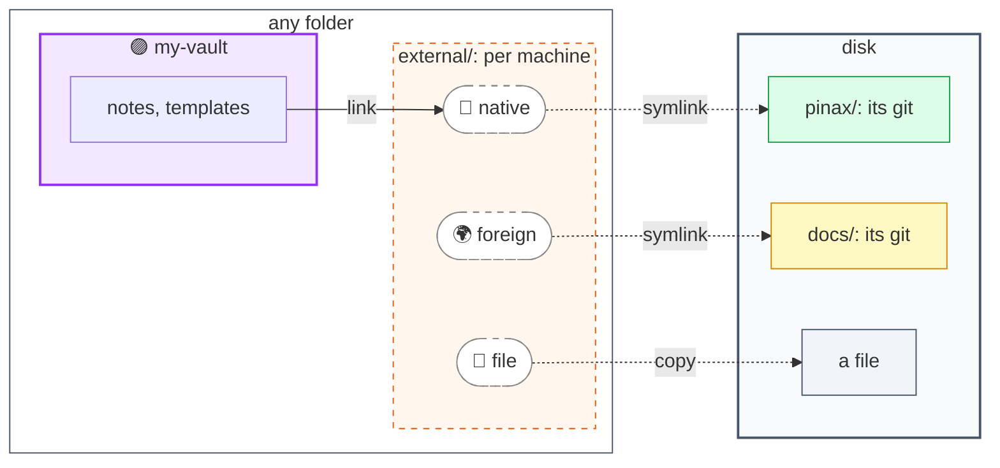

# External



## Rules

- `external/` sits **beside** the vault, never inside it
- a **stable path** to each door:
  `[my-project](../external/my-project/README.md)`
- entries are **per machine**: ignored by git and by any sync tool
- a project missing here: a missing link, not a broken vault
- a project is versioned by **its own git**, never by the vault's sync

## Install

- set per machine, with direnv (`.envrc`, gitignored) or any env tool:
  - `OBSIDIAN_VAULT`: the vault; `external/` sits beside it
  - `PINAX_NAME`: the entry's name in `external/`, else the project
    folder's name
  - `PINAX_DIR`: the pinax folder, else the one holding the module
- one module, [pinax.just](./pinax.just), shipped **inside** the
  pinax folder: copy the folder, the installer comes with it
- one line in the project's `justfile`:

```just
mod pinax "pinax/pinax.just"
```

- `just pinax`: the variables, where `external/` is, and the link
- `just pinax install [vault]`, `just pinax uninstall [vault]`

## Opening from Obsidian

- `[x](../external/…)`: refused by Obsidian alone, "outside the vault"
- Obsidian **1.14+** opens a `.md` outside the vault, natively
- once an external note is open, its own relative links work natively

| Way | Link | Portable | Needs |
| --- | --- | --- | --- |
| 1. the plugin | `[x](../external/p/README.md)` | ✅ | the plugin |
| 2. absolute | `[x](file:///…/p/README.md)` | ❌ | Obsidian, `.md` app |
| 3. scheme, mount | `[x](kb://p/README.md)` | ✅ | a resolver per machine |

- **Portable**: the same link on every machine
- **1, recommended**: the plain relative link of GitHub and VS Code, from
  the note's folder; the plugin opens it, indexes nothing, writes nothing
- **2**: goes through the system's default `.md` app; on Linux, make it
  Obsidian: `xdg-mime default md.obsidian.Obsidian.desktop text/markdown`
- **3**: `kb://` stands for any scheme, or a mount point, that each machine
  maps to its `external/`; the mapping is yours to maintain

## Three kinds

| Kind | What | Promise |
| --- | --- | --- |
| 🧠 native | a pinax, with `pinax.yaml` | this standard |
| 🌍 foreign | any project's `docs/` | none, read as is |
| 📄 file | a one-way copy, **by hand** | no reconciliation |

## A copy's state

- ✅ up to date
- 🔄 source changed
- 💤 source absent here
- 👻 orphaned
- ✏️ copy edited
