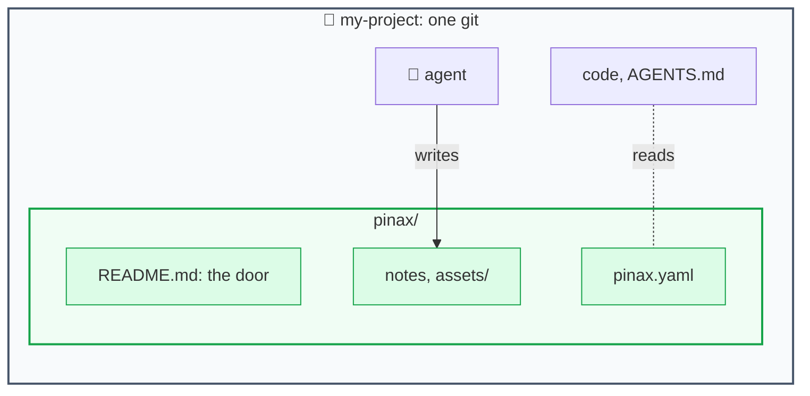

# Folder

```text
my-project/
├── code, AGENTS.md…
└── pinax/              or docs/: any name
    ├── pinax.yaml      the description
    ├── pinax.just      the installer, `just pinax install`
    ├── README.md          the door
    ├── potato.md          the notes
    ├── <topic>/           subfolders, if needed
    └── assets/            images, pdf
```

## `pinax.yaml`

- **visible**: a colleague or an agent finds it and understands
- **versioned** like the rest: [this one](./pinax.yaml)

```yaml
name: my-project
door: README.md
links: markdown
```

## Rules

- **Door**: `README.md`, every note reachable by links from it
- **Links**: relative markdown `[x](./topic/note.md)`, never `[[wikilink]]`
- **Direction**: inward only, never out to the vault
- **Relations**: in the body, or in frontmatter as quoted markdown links,
  like this note's
- **Attachments**: ``, never `![[x.png]]`
- **Badge**: on the root `README.md`, never in the folder: see below
- **`AGENTS.md`**: one line, so any agent follows the standard

```text
Notes in pinax/ follow the Pinax standard: relative markdown links
only, no wikilinks, no links out of the folder.
```

## Badge

Like the Kanon's sign: a visitor landing on the project learns, at once,
that it plugs into a vault and how.

- **Where**: the project's **root** `README.md`, the page the forge shows
  first, with the other badges under the title
- **Never** in `pinax/README.md`: the badge is how a visitor finds the
  pinax from outside
- **Link**: from the root to the door, `pinax/README.md`, or the
  folder's own name (`docs/README.md`)

```markdown
[](pinax/README.md)
```

- **Below it**, a short section of the root `README.md`:

````markdown
## Pinax

This project's notes plug into an Obsidian vault:
[pinax/](pinax/README.md).

```sh
export OBSIDIAN_VAULT=<vault>
just pinax install
```
````

## One git



- **By default**: `pinax/` is a folder of the project, in its git
- **A second git**, only for a real need

| Need | Example |
| --- | --- |
| share one without the other | public code, private notes |
| two rhythms, two authors | the author in Obsidian, the agent on the code |
| sync differently | the pinax across machines, not the code |
