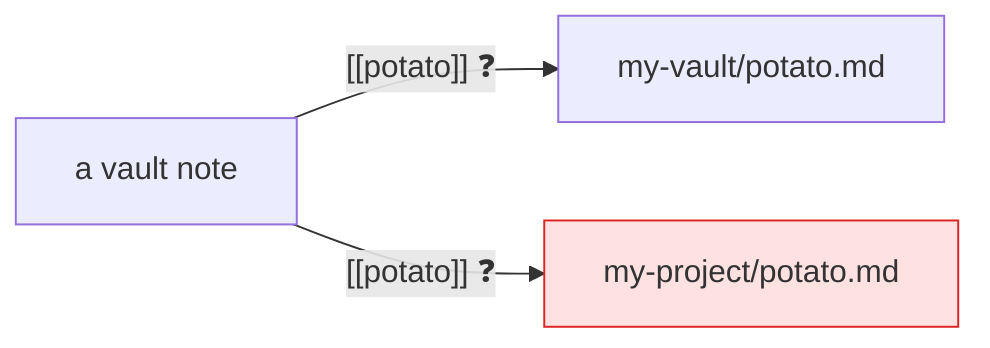

# Naming

## The problem

- drop a project in the vault: its notes **shadow** yours
- "Excluded files" hides them, but they still resolve

## Name resolution

- Obsidian looks up `[[potato]]` by **name**, across the whole vault
- two files, one name: the rule that picks one is undocumented

## Link formats

| Format                     | Example                  | Obsidian | GitHub | VS Code | ADO |
| -------------------------- | ------------------------ | -------- | ------ | ------- | --- |
| 🟣 wikilink, name          | `[[potato]]`             | ✅        | ❌      | ❌       | ❌   |
| 🟣 wikilink, relative path | `[[../potato]]`          | ✅        | ❌      | ❌       | ❌   |
| 🟣 wikilink, absolute path | `[[my-folder/…/potato]]` | ✅        | ❌      | ❌       | ❌   |
| 🔵 markdown, relative path | `[x](./potato.md)`       | ✅        | ✅      | ✅       | ✅   |

- alias: `[[potato|shown text]]`
- attachment: `![[x.png]]` or ``

## The "New link format" setting

- **Shortest path when possible** (the default): the name alone, or a path
  when the name already exists twice
- **Relative path**: from the note
- **Absolute path in vault**: from the vault root
- it only affects links written from now on: existing short links are never
  rewritten when a duplicate name appears later

## So

- a project stays **out** of the vault
- its notes use **relative markdown** only
